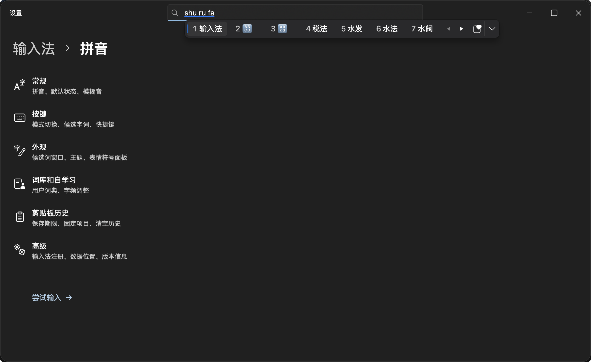

# Fluent IME · Fluent Pinyin

**Language:** [简体中文](README.md) | [繁體中文](README.zh-Hant.md) | [English](README.en.md)

**Fluent IME (Fluent Pinyin)** is a native macOS input method built with **macOS InputMethodKit + Rime + FluentKit**, supporting Simplified Chinese, Traditional Chinese, and English. Its candidate bar, emoji flyout, and settings window bring the Windows 11 Microsoft Pinyin (Fluent Design) visual experience to macOS using pure AppKit windows and controls—**with zero WebViews, Electron, global keyloggers, or Accessibility permissions**.

---

## Screenshots

### Dark Theme & Horizontal Candidate Bar


### Light Theme & Settings Home


---

## Key Features

### 1. Fast, Accurate Pinyin & Multi-Mode Typing
- **Seamless Mode Switching**: Switch freely between Simplified Chinese, Traditional Chinese (powered by standard OpenCC conversion), and English modes, with customizable active modes and default state.
- **Full & Short Pinyin**: Supports full pinyin, initial abbreviations, full-sentence composition, and adaptive personal word-frequency learning.
- **Typo Correction & Fuzzy Pinyin**: Includes adjacent-key spelling correction and 8 independent fuzzy pinyin toggles (`z/zh`, `c/ch`, `s/sh`, `n/l`, `f/h`, `an/ang`, `en/eng`, `in/ing`). All schema combinations use precompiled prisms for instant switching while always prioritizing exact pinyin matches over fuzzy candidates.

### 2. Native Fluent Design UI & Motion
- **Refined Candidate Window**: A cursor-following single-row bar (7 candidates per page) that expands on demand into a continuous 6-column scrolling grid.
- **Themes & Translucent Materials**: Supports Light, Dark, and System appearance, optional Acrylic translucent blur backgrounds, and smooth animations for window fade-in, paging, and grid expansion (automatically respecting macOS *Reduce Motion* and *Reduce Transparency* preferences).
- **Per-Language Fonts & Interface Localization**: Choose any installed Mac font independently for Simplified Chinese, Traditional Chinese, and English. Switch the UI language between Simplified Chinese, Traditional Chinese, and English anytime without affecting your typing modes.

### 3. Dual On-Device Language Models (100% Offline)
- **Wanxiang Sentence Grammar** (Enabled by default): Combines a comprehensive 1.67M-entry Wanxiang dictionary (covering core vocabulary, heteronyms, personal names, and places) with Rime's native Octagram grammar plugin for accurate full-sentence conversion.
- **Contextual Candidate Re-ranking** (Experimental, off by default): Runs a local Chinese RoBERTa model in the background via Core ML using recent context from the active text field to re-rank homophone candidates on the first page—never blocking keystrokes or sending data over the network.

### 4. Emoji, Symbols & Local GIF Panel
- **All-in-One Symbols Flyout**: Browse Fluent Emoji, kaomoji, and special symbols with instant keyword search in Chinese, pinyin, or English (e.g., `微笑`, `weixiao`, or `smile`).
- **Inline Emoji Candidates**: Suggests matching emoji and kaomoji directly inside the candidate bar as you type (e.g., `she → 🐍`, `ku → /(ㄒoㄒ)/~~`).
- **Local GIF Library**: Import up to 100 local animated GIFs with live previews; click any GIF to copy and press `⌘V` to paste into chat or document apps—completely offline with no external GIF network services.

### 5. Privacy-First Clipboard History
- **Rich Formats & Flexible Expiration**: Disabled by default. When enabled, captures plain text, rich text, images, links, and file references (up to 50 items or 50 MB). Click text entries to insert directly, or click images and files to copy and paste with `⌘V`.
- **In-Memory & Encrypted Storage**: Unpinned items remain strictly in memory and expire automatically after 15 minutes, 30 minutes, 1 hour, 24 hours, 7 days, or on quit. Pinned items use **AES-256-GCM** by default, with a key stored in your macOS login Keychain. Encryption can be turned off in Clipboard settings; files then rely on permissions for the current account.
- **Automatic Privacy Filtering**: Automatically ignores secure password fields, private pasteboard markers, and Universal Clipboard items from other devices.

---

## Installation & Uninstallation

### Using the Setup DMG (Recommended)

The standard edition includes the Wanxiang dictionary and grammar model. Files marked `Full` also include the Transformer.

The Transformer is also available as `Fluent-IME-Transformer.zip`. Extract it, then import it in **Input method → Language models**. The same page accepts replacement `.gram` grammar models.

Open `dist/Fluent-IME-<version>-Setup.dmg` and double-click **Fluent IME Setup**:
1. **No Administrator Privileges Required**: Installs directly into `~/Library/Input Methods/Fluent IME.app` for the current user.
2. **Guided Setup**: Walks you through enabling the input source, keeping/merging or archiving an existing user dictionary, and selecting your preferred input languages.
3. **Automatic Installer Cleanup**: Once setup finishes, the installer automatically moves itself to the Trash (and ejects and trashes the DMG if launched from a disk image).
4. If "Fluent Pinyin" does not appear in the macOS input menu immediately, add it manually in **System Settings → Keyboard → Text Input → Edit** (some macOS versions may require logging out and back in to refresh the system input source cache).

### Uninstalling
Go to **Fluent Pinyin Settings → Advanced → Uninstall input method**:
- By default, *Keep settings, dictionaries, and pinned items* is checked.
- Unchecking it will permanently remove all preferences, learned user dictionaries, backups, saved GIFs, and pinned clipboard items before quitting.

---

## Keyboard Shortcuts

| Shortcut | Action |
| :--- | :--- |
| `Space` | Commit the highlighted candidate |
| `1` – `7` | Select the corresponding candidate on the current page (or visible grid row) |
| `←` / `→` | Navigate candidates; pressing left from the first candidate enters the pinyin string to adjust syllable/character segmentation |
| `↑` / `↓`, `Tab` / `Shift+Tab` | Move candidate selection (moves by full row when expanded into a grid) |
| `[` / `]`, `−` / `=`, `Page Up` / `Page Down` | Previous / next candidate page |
| `]` / `[` | Press `]` while typing to expand the candidate grid; use `[ / ]` to page, or press `[` on the top row to collapse |
| `Home` / `End` | Jump the pinyin caret to the beginning / end |
| `Enter` | Commit raw pinyin letters |
| `Esc` | Clear current pinyin composition |
| `Backspace` / `Delete` | Edit or delete pinyin composition |
| `Shift` (Single tap) | Cycle through enabled Simplified Chinese, Traditional Chinese and English modes; switching to English commits the raw letters |
| `Caps Lock` | Turn Caps Lock on or off |

---

## Architecture & Data Locations

```text
Host App Text Input Client (NSTextInputClient)
  → InputMethodKit / FluentInputController
  → InputSession (Key handling, mode switching, contextual ranking & commit policy)
  → RimeEngine / CRimeBridge / librime (Wanxiang dictionary + Octagram grammar)
  → Marked Text Preedit + Commit back to Host App
  → AppKit NSPanel + FluentKit (Candidate bar, Emoji panel & Settings window)
```

- **Installed Input Method Bundle**: `~/Library/Input Methods/Fluent IME.app`
- **User Dictionary & Learning Data**: `~/Library/Application Support/FluentIME/Rime`
- **Archived Dictionary Backups**: `~/Library/Application Support/FluentIME/DictionaryBackups`
- **Encrypted Pinned Clipboard Vault**: `~/Library/Application Support/FluentIME/Private/Clipboard/pinned.aesgcm`
- **Preferences Domain**: `org.fluentime.inputmethod.FluentIME` (`UserDefaults`)
- *Note: Fluent Pinyin maintains its own isolated data directories and never reads, modifies, or shares data with Squirrel, WeType, or other input methods.*

---

## Building from Source

### Requirements
- **OS**: macOS 13 or later (Apple Silicon builds inherit the minimum macOS deployment version of the linked `librime` dynamic libraries)
- **Toolchain**: Xcode / Command Line Tools (Swift 5.9+), Python 3.11+
- **Dependencies**: FluentKit resolves through GitHub SPM (minimum 0.2.0; `Package.resolved` pins 0.3.0). The build script downloads and verifies the Rime runtime. No Homebrew or local FluentKit checkout is required.

### Build & Development Commands

```bash
# 1. Build the Release app bundle (generates schemas, compiles dictionaries, bundles dylibs & ad-hoc signs)
bash scripts/build.sh

# 2. Run the full unit test suite
swift test --jobs 8

# 3. Preview Settings and test live Rime conversion without installing system-wide
open 'dist/Fluent IME.app' --args --preview

# 4. Install or update the input method in ~/Library/Input Methods
bash scripts/install.sh

# 5. Package the standalone Setup app and distribution DMG (requires dmgbuild==1.6.7 and CairoSVG)
python3 scripts/package-installer.py
python3 scripts/package-dmg.py
```

To override local dependency paths or build in Debug mode:

```bash
FLUENTKIT_PATH='/path/to/WinUI-macOS' RIME_PREFIX='/path/to/rime-runtime' bash scripts/build.sh
CONFIGURATION=debug bash scripts/build.sh
```

### Localization Workflow

UI strings live in `Sources/FluentIMECore/Resources/{zh-Hans,zh-Hant,en}.lproj/Localizable.strings`. After editing any `.strings` catalog, regenerate the typed Swift accessors and run the validation check:

```bash
python3 scripts/localize.py
python3 scripts/localize.py --check
```

---

## License & Acknowledgments

- Original code in this project is released under the **[MIT License](LICENSE)**.
- Bundled third-party open-source components and datasets retain their original licenses:
  - **FluentKit** & **Microsoft Fluent Emoji**: MIT License
  - **librime** & **librime-octagram**: BSD 3-Clause License
  - **OpenCC**: Apache License 2.0 / BSD 2-Clause License
  - **rime-pinyin-simp**: Apache License 2.0
  - **Wanxiang Dictionary & Wanxiang LTS Grammar Model**: CC BY 4.0
  - **HFL Chinese RoBERTa-wwm-ext** (Optional on-device re-ranker): Apache License 2.0
- See [`THIRD_PARTY_NOTICES.md`](THIRD_PARTY_NOTICES.md) and `Contents/Resources/Licenses/` inside the app bundle for complete license texts and component inventories.
