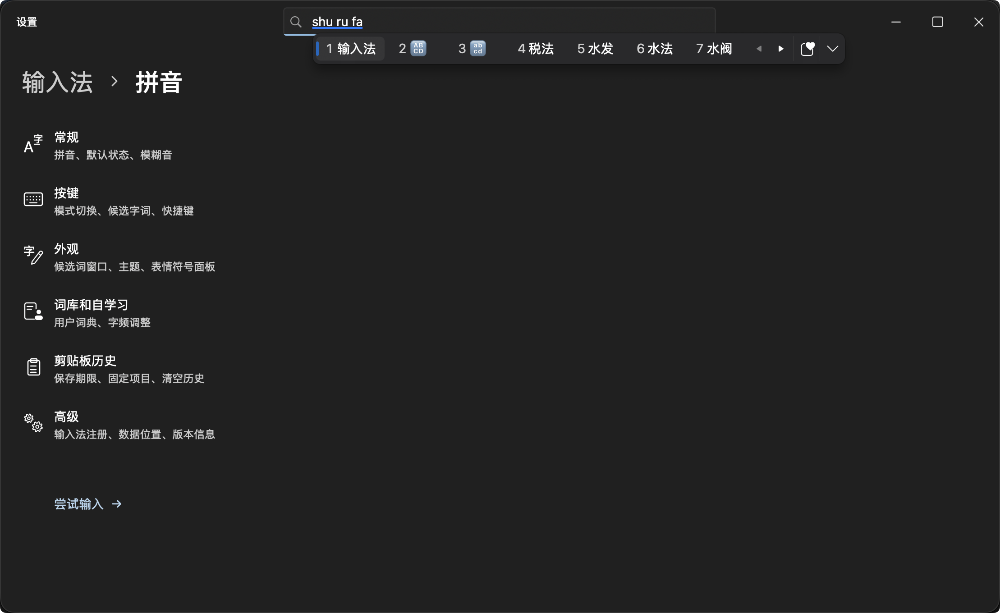
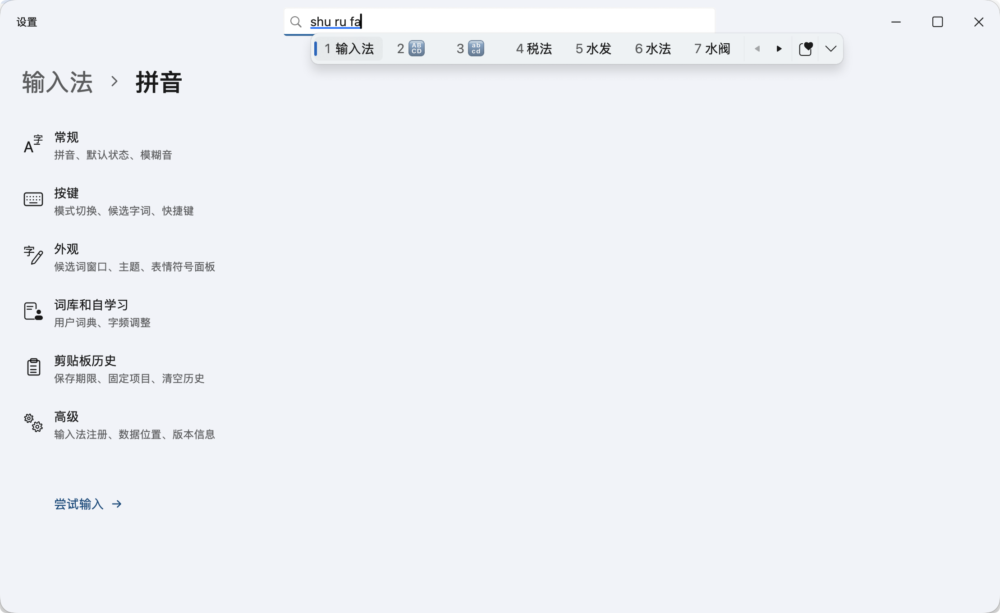

# Fluent IME · Fluent 拼音

**语言 / Language：** [简体中文](README.md) | [繁體中文](README.zh-Hant.md) | [English](README.en.md)

**Fluent IME（Fluent 拼音）** 是一款基于 **macOS InputMethodKit + Rime + FluentKit** 构建的原生输入法，支持简体中文、繁体中文与英文输入。候选词窗口、表情面板与设置中心复刻了 Windows 11 微软拼音的 Fluent Design 视觉语言，完全使用 AppKit 原生窗口与控件渲染——**不依赖浏览器、WebView、Electron、全局键盘监听或辅助功能权限**。

---

## 界面预览

### 深色主题与候选栏


### 浅色主题与设置中心


---

## 核心特性

### 1. 纯正高效的拼音与多语言输入
- **多模式自由切换**：支持简体中文、繁体中文（基于 OpenCC 标准转换）与英文模式，可自定义启用列表与默认状态。
- **全拼与简拼**：支持全拼、首字母简拼、长句连续组词及个人输入习惯与词频自动学习。
- **智能纠错与模糊音**：支持相邻按键拼写纠错，内置 8 组独立模糊音开关（`z/zh`、`c/ch`、`s/sh`、`n/l`、`f/h`、`an/ang`、`en/eng`、`in/ing`）。所有方案索引均已预编译，切换配置零延迟且准确拼写始终优先于模糊匹配。

### 2. 原生 Fluent Design 视觉与交互
- **精致候选窗口**：光标跟随的单行候选栏（每页 7 个候选词），支持按键或点击展开为 6 列连续滚动网格，按需加载。
- **主题与材质效果**：支持浅色、深色及跟随系统外观；可选开启亚克力（Acrylic）半透明背景材质，并提供候选窗淡入、翻页过渡与面板展开动画（自动遵循 macOS“减少动态效果”与“减少透明度”无障碍设置）。
- **独立字体与界面语言**：支持为简体中文、繁体中文和英文分别指定本机已安装字体；界面语言支持简体中文、繁体中文与英文独立切换，不影响打字输入方案。

### 3. 本地双层语言模型（100% 离线）
- **万象长句语法模型**（默认开启）：内置约 167 万词条的万象综合词库（涵盖基础词库、多音字、人名与地名），配合 Rime 原生 Octagram 语法插件，大幅提升整句连续输入的组词准确度。
- **上下文智能重排**（实验性，默认关闭）：通过 Core ML 在后台运行本地中文 RoBERTa 模型，参考当前输入框近期上文对首屏同音候选词进行无感重排。不阻塞打字响应，切换窗口或关闭时自动清空上下文，绝不联网上传。

### 4. 表情、特殊符号与本地 GIF 面板
- **多合一符号浮窗**：集成绘文字（Fluent Emoji）、颜文字与特殊符号，支持使用中文、全拼或英文关键词检索（如输入 `微笑`、`weixiao` 或 `smile`）。
- **候选栏内联表情**：打字时直接在候选栏提供表情与颜文字联想（如 `she → 🐍`、`ku → /(ㄒoㄒ)/~~`）。
- **本地 GIF 收藏**：支持导入本地 GIF 动图（上限 100 个），保留完整动画预览；点击即可复制并按 `⌘V` 粘贴到聊天或文档应用中，不连接任何第三方 GIF 网络服务。

### 5. 隐私优先的剪贴板历史
- **多种格式与期限管理**：默认关闭；开启后支持记录纯文本、富文本、图片、网页链接与文件引用（上限 50 条或 50 MB）。文本点击可直接上屏，图片与文件点击复制后按 `⌘V` 粘贴。
- **内存暂存与本机加密**：未固定的记录仅暂存于内存，支持设置 15 分钟、30 分钟、1 小时、24 小时、7 天或退出时自动清除；固定记录使用 **AES-256-GCM** 加密保存在本机，密钥托管于 macOS 登录钥匙串。
- **严格隐私过滤**：自动跳过安全输入状态（密码框）、隐私标记内容与跨设备通用剪贴板。

---

## 安装与卸载

### 使用安装向导（推荐）
打开分发镜像 `dist/Fluent-IME-0.6.0-Setup.dmg`，双击运行 **Fluent IME Setup**：
1. **无需管理员权限**：仅安装至当前用户的 `~/Library/Input Methods/Fluent IME.app`。
2. **向导式配置**：自动引导完成输入源启用、既有个人词库合并或归档备份，以及输入语言偏好设置。
3. **自动清理安装包**：完成向导后，安装器会自动移入废纸篓；若从 DMG 磁盘映像启动，将自动推出映像并将 DMG 文件移入废纸篓。
4. 如系统右上角输入法菜单未立即显示“Fluent 拼音”，请前往 **系统设置 → 键盘 → 文字输入 → 编辑** 手动添加（部分 macOS 版本可能需要注销并重新登录以刷新系统输入源缓存）。

### 卸载输入法
前往 **Fluent 拼音设置 → 高级 → 卸载输入法**：
- 默认勾选“保留个人设置、词库与剪贴板固定内容”；
- 若取消勾选，卸载时将一并清理所有偏好设置、个人学习词库、备份、收藏的 GIF 与剪贴板加密文件。

---

## 快捷键一览

| 按键 | 功能说明 |
| :--- | :--- |
| `Space`（空格） | 上屏当前高亮的候选词 |
| `1` – `7` | 选择当前页（或展开网格当前可见行）对应序号的候选词 |
| `←` / `→` | 在候选词间移动焦点；首项向左可进入拼音串逐音节或逐字母调整分词位置 |
| `↑` / `↓`、`Tab` / `Shift+Tab` | 上下移动候选焦点（展开为网格时按整行上下移动） |
| `[` / `]`、`−` / `=`、`Page Up` / `Page Down` | 候选词上一页 / 下一页 |
| `】` / `【` | 输入时按 `】` 展开候选网格；展开后用 `【 / 】` 翻页，在首行按 `【` 收起 |
| `Home` / `End` | 将拼音编辑光标移至开头 / 末尾 |
| `Enter`（回车） | 直接上屏原始拼音字母 |
| `Esc` | 清空当前输入的拼音组合 |
| `Backspace` / `Delete` | 删除或编辑拼音组合 |
| `Shift`（单按） | 切换中英文输入状态（拼音输入中途按 Shift 将直接上屏已输入的字母并切为英文） |
| `Caps Lock` | 开启或关闭大写锁定 |

---

## 架构与数据存储

```text
宿主应用文本输入接口 (NSTextInputClient)
  → InputMethodKit / FluentInputController
  → InputSession（按键处理、语言模式、上下文重排与上屏策略）
  → RimeEngine / CRimeBridge / librime（万象词库 + Octagram 语法模型）
  → Marked Text 预编辑 + 文本上屏回传宿主应用
  → AppKit NSPanel + FluentKit 渲染候选窗口、表情面板与设置中心
```

- **系统输入法安装位置**：`~/Library/Input Methods/Fluent IME.app`
- **个人词库与学习数据**：`~/Library/Application Support/FluentIME/Rime`
- **词库归档备份目录**：`~/Library/Application Support/FluentIME/DictionaryBackups`
- **剪贴板固定项加密存储**：`~/Library/Application Support/FluentIME/Private/Clipboard/pinned.aesgcm`
- **偏好设置存储域**：`org.fluentime.inputmethod.FluentIME`（UserDefaults）
- *注：Fluent 拼音完全独立维护数据目录，不读取、修改或复用鼠须管（Squirrel）、微信输入法等其他输入法的任何配置与词库。*

---

## 从源码构建

### 环境要求
- **操作系统**：macOS 13 及以上（Apple Silicon 构建产物最低系统版本取决于所链接的 `librime` 动态库版本）
- **开发工具**：Xcode / Command Line Tools（Swift 5.9+）、Python 3、Homebrew
- **依赖组件**：`librime` 及本地 `WinUI-macOS`（FluentKit，默认路径 `/Users/stars/Documents/WinUI-macOS`）

### 常用构建与调试命令

```bash
# 1. 构建 Release 应用包（自动生成方案、编译词表、收集动态库并完成本机签名）
bash scripts/build.sh

# 2. 运行全量自动化单元测试
swift test --jobs 8

# 3. 无需安装至系统，直接启动设置窗口并体验真实 Rime 引擎试输入
open 'dist/Fluent IME.app' --args --preview

# 4. 安装或更新到当前用户的系统输入法目录
bash scripts/install.sh

# 5. 打包独立安装引导应用与 DMG 发行镜像（需安装 dmgbuild==1.6.7 与 CairoSVG）
python3 scripts/package-installer.py
python3 scripts/package-dmg.py
```

如需覆盖默认的本地依赖路径或使用 Debug 配置：

```bash
FLUENTKIT_PATH='/path/to/WinUI-macOS' RIME_PREFIX='/path/to/librime' bash scripts/build.sh
CONFIGURATION=debug bash scripts/build.sh
```

### 本地化维护

界面文案位于 `Sources/FluentIMECore/Resources/{zh-Hans,zh-Hant,en}.lproj/Localizable.strings`。修改任意语言文案后，请运行脚本重新生成 Swift 访问器并执行一致性检查：

```bash
python3 scripts/localize.py
python3 scripts/localize.py --check
```

---

## 开源许可与致谢

- 本项目原创代码采用 **[MIT License](LICENSE)** 开源。
- 随包分发的第三方开源组件与数据均保留其原始许可证：
  - **FluentKit** & **Microsoft Fluent Emoji**：MIT License
  - **librime** & **librime-octagram**：BSD 3-Clause License
  - **OpenCC**：Apache License 2.0 / BSD 2-Clause License
  - **rime-pinyin-simp**：Apache License 2.0
  - **万象词库与万象 LTS 语法模型**：CC BY 4.0
  - **HFL Chinese RoBERTa-wwm-ext**（可选本地重排模型）：Apache License 2.0
- 完整的第三方许可证文本与组件清单详见 [`THIRD_PARTY_NOTICES.md`](THIRD_PARTY_NOTICES.md) 及应用包内 `Contents/Resources/Licenses/` 目录。
