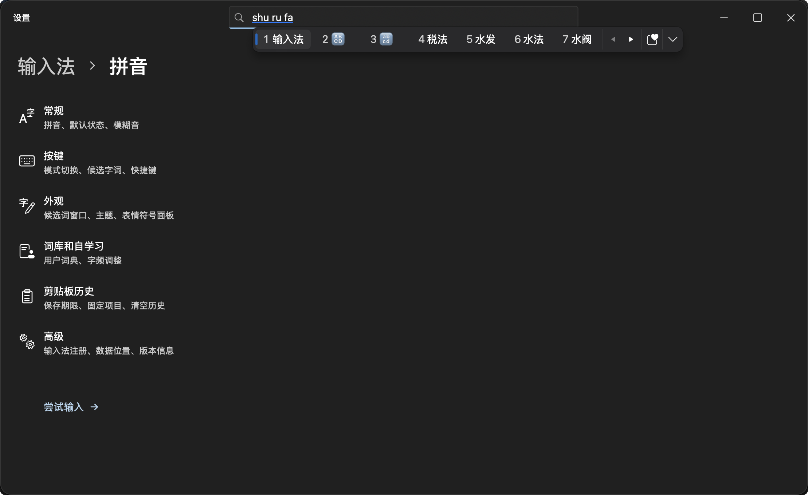
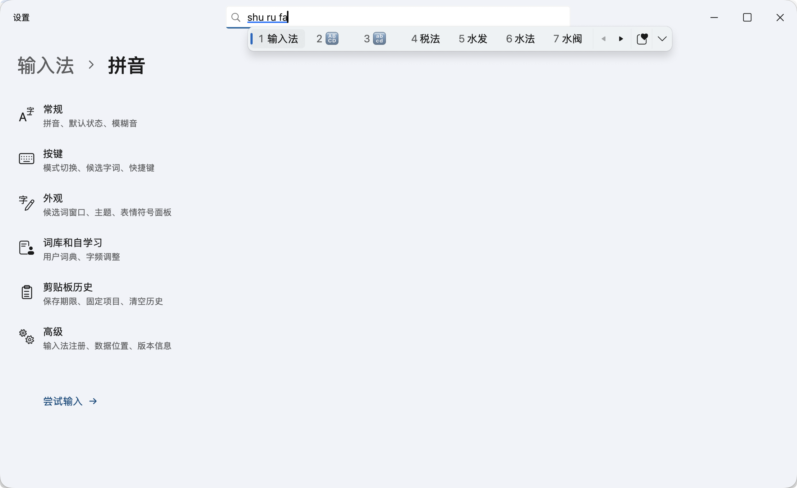

# Fluent IME · Fluent 拼音

**語言 / Language：** [简体中文](README.md) | [繁體中文](README.zh-Hant.md) | [English](README.en.md)

**Fluent IME（Fluent 拼音）** 是一款基於 **macOS InputMethodKit + Rime + FluentKit** 建置的原生輸入法，支援簡體中文、繁體中文與英文輸入。候選字視窗、表情符號面板與設定中心重現了 Windows 11 微軟拼音的 Fluent Design 視覺語言，完全採用 AppKit 原生視窗與控制項繪製——**不依賴瀏覽器、WebView、Electron、全域鍵盤監聽或輔助使用權限**。

---

## 介面預覽

### 深色主題與候選視窗


### 淺色主題與設定中心


---

## 核心特色

### 1. 高效精準的拼音與多語言輸入
- **多模式自由切換**：支援簡體中文、繁體中文（基於 OpenCC 標準轉換）與英文輸入模式，可自訂啟用清單與預設狀態。
- **全拼與簡拼**：支援全拼、字首簡拼、長句連續組字，以及個人輸入習慣與詞頻自動學習。
- **智慧糾錯與模糊音**：支援相鄰按鍵拼寫糾錯，內建 8 組獨立模糊音開關（`z/zh`、`c/ch`、`s/sh`、`n/l`、`f/h`、`an/ang`、`en/eng`、`in/ing`）。所有方案索引均已預先編譯，切換設定零延遲，且精確拼寫始終優先於模糊比對。

### 2. 原生 Fluent Design 視覺與互動體驗
- **精緻候選字視窗**：游標跟隨的單列候選視窗（每頁顯示 7 個候選字詞），支援按鍵或點一下展開為 6 欄連續捲動網格，依需求動態載入。
- **主題與材質效果**：支援淺色、深色及跟隨系統外觀；可選用壓克力（Acrylic）半透明毛玻璃背景材質，並提供候選視窗淡入、翻頁過渡與面板展開動畫（自動遵循 macOS「減少動態效果」與「減少透明度」輔助使用設定）。
- **獨立字型與介面語言**：支援為簡體中文、繁體中文與英文分別指定本機已安裝字型；設定與面板支援簡體中文、繁體中文與英文介面語言獨立切換，不影響打字輸入模式。

### 3. 本機雙層語言模型（100% 離線運算）
- **萬象長句語法模型**（預設開啟）：內建約 167 萬詞條的萬象綜合詞庫（涵蓋常用詞庫、破音字、人名與地名），搭配 Rime 原生 Octagram 語法外掛程式，大幅提升整句連續輸入的組字準確度。
- **上下文智慧重排**（實驗性，預設關閉）：透過 Core ML 在背景執行本機中文 RoBERTa 模型，參考目前輸入框近期上文對首頁同音候選字詞進行智慧重排。不影響打字反應速度，切換視窗或關閉時自動清除上下文，絕不連線傳送任何資料。

### 4. 表情符號、特殊符號與本機 GIF 面板
- **多合一符號浮動視窗**：整合表情符號（Fluent Emoji）、顏文字與特殊符號，支援以中文、拼音或英文關鍵字搜尋（例如輸入 `微笑`、`weixiao` 或 `smile`）。
- **候選視窗內嵌表情**：打字時直接在候選視窗提供表情符號與顏文字聯想（如 `she → 🐍`、`ku → /(ㄒoㄒ)/~~`）。
- **本機 GIF 收藏**：支援加入本機 GIF 動圖（上限 100 個），保留完整動畫預覽；點一下即可拷貝並按 `⌘V` 貼上至對話或文件視窗，不連接任何第三方 GIF 網路服務。

### 5. 隱私優先的剪貼簿記錄
- **多元格式與保留時間管理**：預設關閉；開啟後支援記錄純文字、RTF 格式文字、圖片、網頁連結與檔案（上限 50 筆或 50 MB）。點一下文字可直接送出，圖片與檔案點一下拷貝後按 `⌘V` 貼上。
- **記憶體暫存與本機加密**：未釘選的記錄僅暫存於記憶體，支援設定 15 分鐘、30 分鐘、1 小時、24 小時、7 天或結束輸入法時自動清除；釘選記錄採用 **AES-256-GCM** 加密儲存於本機，金鑰由 macOS 登入鑰匙圈管理。
- **嚴格隱私過濾**：自動略過安全輸入狀態（密碼欄位）、私密標記內容與跨裝置通用剪貼簿。

---

## 安裝與解除安裝

### 使用安裝輔助程式（推薦）

標準版保留萬象詞庫與語法模型，不含 Transformer；檔名帶 `Full` 的版本另含 Transformer。

Transformer 也可單獨下載 `Fluent-IME-Transformer.zip`，解壓縮後在 **輸入法 → 語言模型** 匯入；此頁也可替換 `.gram` 語法模型。

打開安裝映像檔 `dist/Fluent-IME-0.6.0-Setup.dmg`，連按兩下執行 **Fluent IME Setup**：
1. **無需管理者權限**：僅安裝至目前使用者的 `~/Library/Input Methods/Fluent IME.app`。
2. **引導式設定**：自動引導完成輸入來源啟用、既有個人詞庫合併或封存備份，以及輸入語言偏好設定。
3. **自動清理安裝套件**：完成設定後，安裝程式會自動移至垃圾桶；若從 DMG 磁碟映像檔開啟，將自動退出映像檔並將 DMG 檔案移至垃圾桶。
4. 若系統右上角輸入法選單未立即顯示「Fluent 拼音」，請前往 **系統設定 → 鍵盤 → 文字輸入 → 編輯** 手動新增（部分 macOS 版本可能需要登出並重新登入以重新整理系統輸入來源快取）。

### 解除安裝輸入法
前往 **Fluent 拼音設定 → 進階 → 解除安裝輸入法**：
- 預設勾選「保留個人設定、詞庫與剪貼簿釘選內容」；
- 若取消勾選，解除安裝時將一併清除所有偏好設定、個人學習詞庫、備份、收藏的 GIF 與剪貼簿加密檔案。

---

## 快速鍵一覽

| 按鍵 | 功能說明 |
| :--- | :--- |
| `Space`（空白鍵） | 送出目前反白的候選字詞 |
| `1` – `7` | 選取目前頁面（或展開網格目前可見列）對應編號的候選字詞 |
| `←` / `→` | 在候選字詞間移動焦點；首項向左可進入拼音串逐音節或逐字元調整分詞位置 |
| `↑` / `↓`、`Tab` / `Shift+Tab` | 上下移動候選焦點（展開為網格時按整列上下移動） |
| `[` / `]`、`−` / `=`、`Page Up` / `Page Down` | 候選字詞上一頁 / 下一頁 |
| `】` / `【` | 輸入時按 `】` 展開候選網格；展開後用 `【 / 】` 翻頁，在首列按 `【` 收合 |
| `Home` / `End` | 將拼音編輯游標移至開頭 / 結尾 |
| `Enter` | 直接送出原始拼音字母 |
| `Esc` | 清除目前輸入的拼音組合 |
| `Backspace` / `Delete` | 刪除或編輯拼音組合 |
| `Shift`（單按） | 按啟用順序輪換簡體中文、繁體中文和英文；切換為英文時，直接送出已輸入的字母 |
| `Caps Lock` | 開啟或關閉大寫鎖定 |

---

## 架構與資料儲存

```text
宿主應用程式文字輸入介面 (NSTextInputClient)
  → InputMethodKit / FluentInputController
  → InputSession（按鍵處理、語言模式、上下文重排與送出策略）
  → RimeEngine / CRimeBridge / librime（萬象詞庫 + Octagram 語法模型）
  → Marked Text 預先編輯 + 文字送出回傳宿主應用程式
  → AppKit NSPanel + FluentKit 繪製候選視窗、表情面板與設定中心
```

- **系統輸入法安裝路徑**：`~/Library/Input Methods/Fluent IME.app`
- **個人詞庫與學習資料**：`~/Library/Application Support/FluentIME/Rime`
- **詞庫封存備份目錄**：`~/Library/Application Support/FluentIME/DictionaryBackups`
- **剪貼簿釘選項目加密檔案**：`~/Library/Application Support/FluentIME/Private/Clipboard/pinned.aesgcm`
- **偏好設定儲存域**：`org.fluentime.inputmethod.FluentIME`（UserDefaults）
- *註：Fluent 拼音完全獨立維護資料目錄，不會讀取、修改或共用鼠鬚管（Squirrel）、微信輸入法等其他輸入法的任何設定與詞庫。*

---

## 從原始碼建置

### 環境需求
- **作業系統**：macOS 13 及以上（Apple Silicon 建置產物最低系統需求取決於所連結的 `librime` 動態庫版本）
- **開發工具**：Xcode / Command Line Tools（Swift 5.9+）、Python 3、Homebrew
- **依賴元件**：`librime` 及本機 `WinUI-macOS`（FluentKit，預設路徑 `/Users/stars/Documents/WinUI-macOS`）

### 常用建置與測試指令

```bash
# 1. 建置 Release 應用程式套件（自動產生方案、編譯詞表、收集動態庫並完成本機簽署）
bash scripts/build.sh

# 2. 執行完整自動化單元測試
swift test --jobs 8

# 3. 無需安裝至系統，直接啟動設定視窗並體驗真實 Rime 引擎輸入預覽
open 'dist/Fluent IME.app' --args --preview

# 4. 安裝或更新至目前使用者的系統輸入法目錄
bash scripts/install.sh

# 5. 封裝獨立安裝輔助程式與 DMG 發行映像檔（需安裝 dmgbuild==1.6.7 與 CairoSVG）
python3 scripts/package-installer.py
python3 scripts/package-dmg.py
```

如需覆寫預設的本機依賴路徑或使用 Debug 組態：

```bash
FLUENTKIT_PATH='/path/to/WinUI-macOS' RIME_PREFIX='/path/to/librime' bash scripts/build.sh
CONFIGURATION=debug bash scripts/build.sh
```

### 在地化維護

介面文案位於 `Sources/FluentIMECore/Resources/{zh-Hans,zh-Hant,en}.lproj/Localizable.strings`。修改任何語言文案後，請執行腳本重新產生 Swift 存取器並執行一致性檢查：

```bash
python3 scripts/localize.py
python3 scripts/localize.py --check
```

---

## 開放原始碼授權與致謝

- 本專案原創程式碼採用 **[MIT License](LICENSE)** 授權。
- 隨附發佈的第三方開放原始碼元件與資料均保留其原始授權條款：
  - **FluentKit** & **Microsoft Fluent Emoji**：MIT License
  - **librime** & **librime-octagram**：BSD 3-Clause License
  - **OpenCC**：Apache License 2.0 / BSD 2-Clause License
  - **rime-pinyin-simp**：Apache License 2.0
  - **萬象詞庫與萬象 LTS 語法模型**：CC BY 4.0
  - **HFL Chinese RoBERTa-wwm-ext**（選用本機重排模型）：Apache License 2.0
- 完整的第三方授權條款全文與元件清單請參閱 [`THIRD_PARTY_NOTICES.md`](THIRD_PARTY_NOTICES.md) 及應用程式套件內 `Contents/Resources/Licenses/` 目錄。
